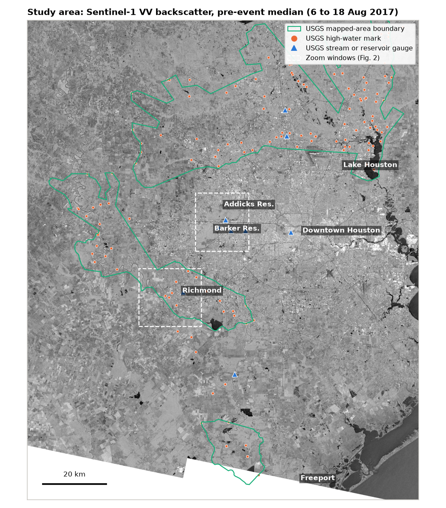
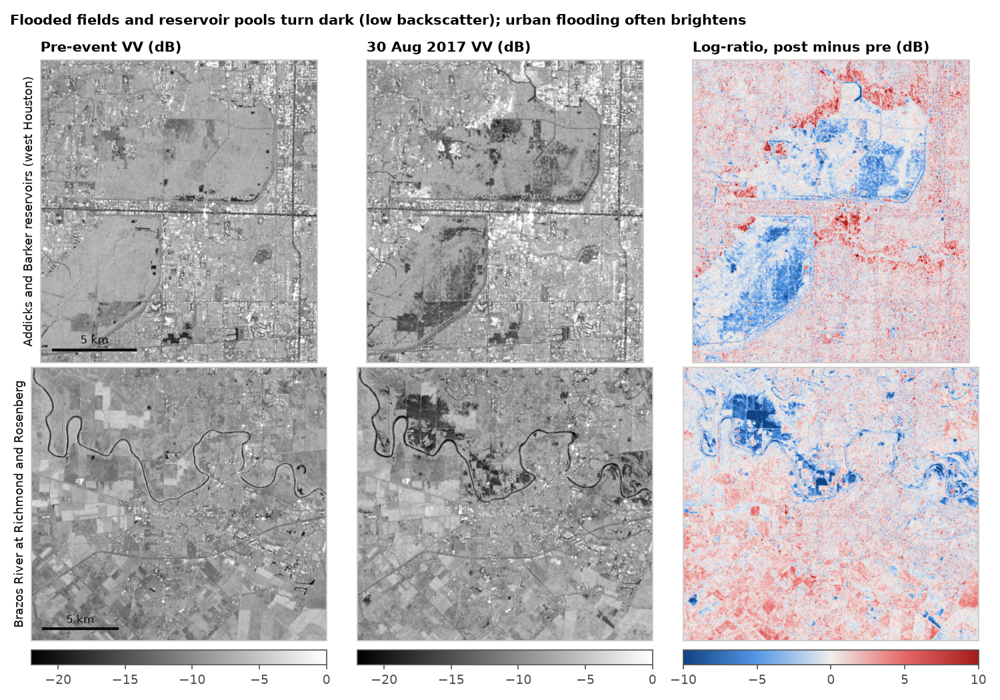
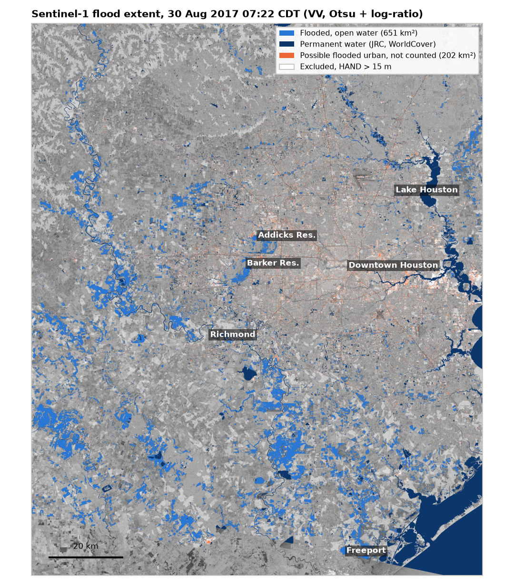
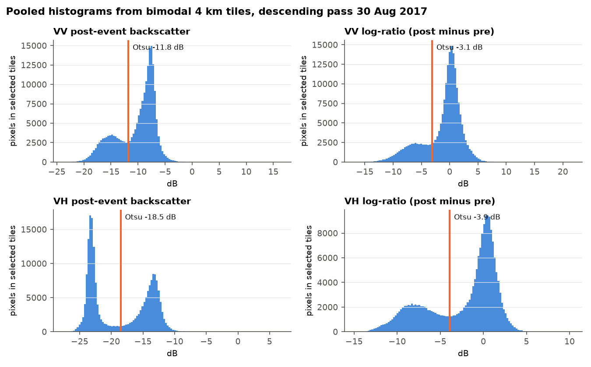
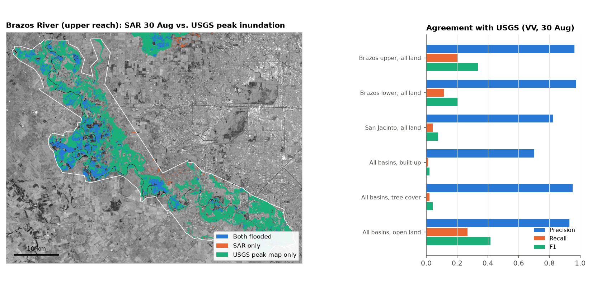
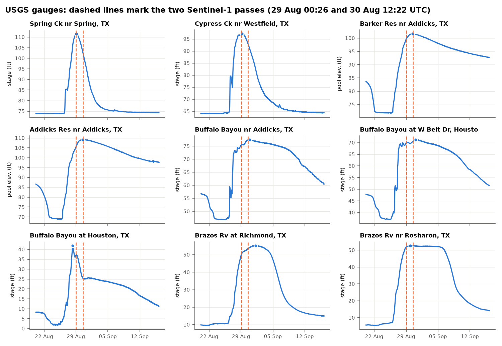
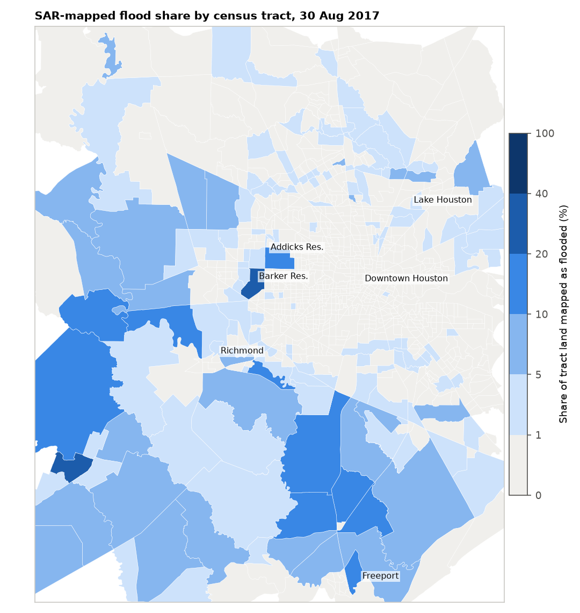

# Hurricane Harvey Flood Mapping with Sentinel-1 SAR (Houston and the Lower Brazos, 2017)

Anamika Dristi, Ph.D.

This project maps open-water flooding from Hurricane Harvey (late August 2017) across west and north Houston (Addicks and Barker reservoirs, Buffalo Bayou, Cypress and Spring creeks, Lake Houston) and the lower Brazos River lowlands, using Sentinel-1 C-band radar. Pre-event (6 to 18 August) and post-event (29 and 30 August) radiometrically terrain-corrected backscatter from the Microsoft Planetary Computer was speckle filtered, thresholded with split-based Otsu, and combined with log-ratio change detection. Permanent water (JRC Global Surface Water, ESA WorldCover) and high ground (HAND above 15 m, from the USGS 3DEP DEM) were masked. The 30 August map shows **651 km² of open-water flooding** within an 18,970 km² study area. Compared with independent USGS peak-inundation maps, the SAR flood pixels were usually correct (**precision 0.93**), but the SAR map found only a small part of the USGS peak extent (**recall 0.11, F1 0.19**). The misses were concentrated under tree canopy and in built-up areas. Flooded area, population and housing exposure are summarized by census tract, ZIP code (ZCTA) and county.

This is an independent analysis of public data. It is separate from my LSU dissertation datasets and uses none of them.

## Why it matters

Radar is often the only satellite view of a flood while clouds are still overhead, so SAR flood maps are a standard first product for emergency managers, floodplain managers, and public health teams in Texas and Louisiana. This project covers tasks that show up in environmental scientist, environmental health and GIS or remote sensing roles: pulling cloud-hosted satellite data, building a reproducible raster pipeline, masking with terrain and land cover, checking results against independent field-based data, and turning a flood extent into population and housing exposure by census geography. The validation step also shows where SAR flood maps should not be trusted, which matters when such maps are used to decide where to send help.

## Data sources

All data are public and were accessed anonymously, with no account or API key, on 23 October 2026.

| Data | Provider and ID | Use |
|---|---|---|
| Sentinel-1 RTC gamma0, VV and VH, 10 m (read at 20 m) | Microsoft Planetary Computer STAC, collection `sentinel-1-rtc` (Catalyst RTC of Copernicus Sentinel-1 GRD, CC BY 4.0), https://planetarycomputer.microsoft.com/dataset/sentinel-1-rtc | Flood detection. 9 scene frames listed in `outputs/tables/sentinel1_scenes_used.csv` |
| JRC Global Surface Water v1.3, occurrence 1984 to 2020 | Planetary Computer `jrc-gsw` (Pekel and others, 2016) | Permanent-water mask (occurrence of 75 percent or more) |
| ESA WorldCover 2020 v100, 10 m | Planetary Computer `esa-worldcover` (CC BY 4.0) | Permanent water (class 80), built-up (class 50), tree cover, land-cover summaries |
| USGS 3DEP DEM, 1/3 arc-second | Planetary Computer `3dep-seamless` (tiles ending `-13`) | HAND and slope |
| USGS Hurricane Harvey flood-inundation polygons, mapped-area boundaries and high-water marks | Watson and others (2018), USGS data release doi:10.5066/F7VH5N3N, ScienceBase items 5aa02374e4b0b1c392e68400 (Brazos River) and 5aa023ebe4b0b1c392e6881b (San Jacinto River) | Independent validation |
| ACS 2017 5-year tract estimates with TIGER/Line geometry, Texas | U.S. Census Bureau, `ACS_2017_5YR_TRACT_48.gdb.zip`, https://www2.census.gov/geo/tiger/TIGER_DP/2017ACS/ | Population (B01001), housing units (B25001), poverty (B17001) |
| 2017 cartographic ZCTA boundaries (500k) | U.S. Census Bureau, `cb_2017_us_zcta510_500k.zip` | ZIP-level summaries |
| USGS NWIS instantaneous values, gage height (00065) and reservoir elevation NAVD88 (62615) | https://waterservices.usgs.gov, 9 sites, 20 Aug to 15 Sep 2017, 22,867 values | Timing of SAR passes relative to flood peaks (`data/nwis_gauges_harvey_2017.csv`) |

Notes on sources:
- The Planetary Computer `sentinel-1-rtc` collection does cover 2017 over Harris County, so the Harvey event could be used as planned. The `sentinel-1-grd` collection also covers it, but RTC was chosen because it is already terrain flattened and in UTM.
- Pre-event scenes: descending relative orbit 143 on 6, 12 and 18 August (median composite), ascending orbit 34 on 5 August. Post-event: descending orbit 143 on 30 August 2017 at 12:22 UTC (07:22 CDT, Sentinel-1B), and ascending orbit 34 on 29 August at 00:26 UTC (19:26 CDT on 28 August, Sentinel-1A).
- The Census API now requires a key, so population came from the keyless TIGER/Line demographic geodatabase instead.
- The USGS STN web services for high-water marks now go through a keyed API, so the high-water marks used here are the ones published with the USGS data release above (145 sites inside the study area).
- Copies of the HWM table in this repository keep the site number, waterbody, peak date and height above ground, but drop the surveyor name field.

## Methods

Scripts are in `scripts/` and run in order (`scripts/run_all.sh`).

1. **Download** (`01_download_data.py`). Queries the STAC API, signs asset URLs with the `planetary-computer` package, and reads each scene's 20 m internal overview for a window over the study area (west -96.25, south 29.00, east -95.00, north 30.35). The analysis grid is UTM 15N, 20 m, 6,222 x 7,622 pixels. Frames from the same pass are mosaicked. Ancillary rasters are warped onto the same grid (nearest for JRC, mode for WorldCover, average for the DEM).
2. **Speckle filtering** (`02_preprocess_sar.py`). Per-pixel median of the three pre-event descending dates, then a 7 x 7 Lee filter on linear gamma0, then conversion to dB. The equivalent number of looks was estimated from the most homogeneous 10 percent of windows: about 13 for single dates and 21 to 23 for the median composite.
3. **HAND** (`03_hand_dem.py`). The 3DEP DEM was conditioned with pysheds (fill pits and depressions, resolve flats). D8 flow directions and accumulation were computed, and cells draining more than 1 km² were used as the drainage network. HAND is the height above the drainage cell each pixel flows to (Nobre and others, 2011). Median HAND in the study area is 1.9 m.
4. **Flood detection** (`04_flood_detection.py`).
   - Log-ratio change image: d = post dB minus pre dB.
   - Split-based Otsu: the image was cut into 4 x 4 km tiles. The 30 tiles with the clearest bimodality (Ashman D above 2, dark class between 10 and 90 percent of the tile) were pooled, and Otsu's threshold was computed on the pooled pixels (after Martinis and others, 2009). This was done separately for post-event backscatter and for d.
   - Open-water flood = post-event backscatter below the Otsu threshold AND d below its threshold, outside permanent water, with HAND of 15 m or less (Twele and others, 2016).
   - Patches smaller than 10 pixels (0.4 ha) were removed.
   - VV is the primary map. VH and the single-criterion versions were kept for comparison.
   - Built-up pixels with a VV increase above 3 dB were flagged as "possible flooded urban" (double bounce) but were not counted as flood.
5. **Validation** (`05_validation.py`). The SAR maps were compared with the USGS inundation polygons inside each USGS mapped-area boundary (upper Brazos, lower Brazos, San Jacinto). Only pixels the SAR map could call flooded were compared (valid data, not permanent water, HAND of 15 m or less). The script reports overall accuracy, precision, recall, F1 and Cohen's kappa, split by WorldCover class. As a point check, it reports the share of USGS high-water-mark sites with SAR flood within 60 m.
6. **Exposure** (`06_exposure_stats.py`). Flooded land area was summed for 1,002 census tracts and 212 ZCTAs whose centroids fall in the study area. Population exposure uses two rules:
   - area-weighted: tract population times the flooded share of tract land;
   - built-up dasymetric: tract population spread over WorldCover built-up pixels.
7. **Figures and GIS export** (`07_figures.py`).

## Key findings

Numbers are from the run recorded in `outputs/tables/`.

**Flood extent (descending pass, 30 August 2017, 07:22 CDT)**
- Open-water flood (VV): **651.0 km²** out of 17,944 km² of valid SAR coverage.
  - Masked as permanent water: 860.3 km².
  - Excluded as high ground (HAND above 15 m, or no HAND value): 2,109 km².
- Otsu thresholds:
  - VV: -11.8 dB for post-event backscatter and -3.1 dB for change.
  - VH: -18.5 dB and -3.9 dB.
- The VH map found 793 km². VV and VH agreed on 530 km² (Jaccard 0.58).
- By land cover, the flooded share was:
  - cropland 9.9 percent (205 km²);
  - herbaceous wetland 7.5 percent;
  - grassland 6.4 percent (348 km²);
  - tree cover 0.8 percent (53 km²);
  - built-up 0.2 percent (3.4 km²).
- Possible flooded urban (built-up pixels with a VV increase above 3 dB, not counted as flood): 201.6 km².
- The ascending pass on the evening of 28 August (local time) gave 940.5 km² with its own thresholds (VV -11.5 dB, change -2.2 dB). Different look geometry, a single pre-event date and different flood timing all contribute to this difference.
- The Addicks and Barker reservoir pools show up as large dark areas with drops of 5 to 10 dB (Figure 2). The USGS Addicks reservoir gauge peaked at 109.09 ft (NAVD88) at 12:00 UTC on 30 August, 22 minutes before the descending pass. Barker peaked at 101.59 ft at 09:50 UTC the same day (Figure 6).
- On the Brazos at Richmond, stage was 53.35 ft at the descending pass, and the river crested at 55.19 ft on 1 September (05:15 UTC). Spring Creek and Cypress Creek peaked about 2 to 4 hours after the ascending pass and had dropped 4 to 9 ft by the descending pass.

**Agreement with USGS peak-inundation maps (descending, VV, pooled over three basins)**

| Land cover | Ref. flood km² | SAR flood km² | OA | Precision | Recall | F1 | Kappa |
|---|---|---|---|---|---|---|---|
| All land | 1,212.9 | 139.0 | 0.658 | 0.932 | 0.107 | 0.192 | 0.123 |
| Open land (grass, crop, bare, wetland) | 421.8 | 121.5 | 0.706 | 0.931 | 0.268 | 0.417 | 0.293 |
| Tree cover | 735.9 | 16.7 | 0.603 | 0.951 | 0.022 | 0.042 | 0.025 |
| Built-up | 55.1 | 0.8 | 0.820 | 0.702 | 0.011 | 0.021 | 0.016 |

- By basin (all land, VV, 30 August):
  - upper Brazos: F1 0.336 (precision 0.963, recall 0.204);
  - lower Brazos: F1 0.206;
  - San Jacinto basin (Cypress and Spring creeks, Lake Houston): F1 0.078. Its creeks had already fallen well below peak by the time of the pass.
- Method comparison, pooled, 30 August:

  | Method | F1 | Precision | Recall |
  |---|---|---|---|
  | Otsu only | 0.255 | 0.713 | 0.155 |
  | Log-ratio only | 0.209 | 0.927 | 0.117 |
  | Combined (primary map) | 0.192 | 0.932 | 0.107 |
  | VH combined | 0.177 | 0.930 | 0.098 |

  Adding the change test removes many false positives from naturally dark surfaces (roads, smooth bare fields, shadows), at a small cost in recall.
- High-water marks: 145 USGS HWM sites fall in the study area. Only 4.8 percent (30 August) and 5.5 percent (29 August) had SAR flood within 60 m. Many site descriptions name road crossings, bridges or buildings, where open-water SAR detection is weak, and the marks record the peak, not the water level at the radar pass.
- About 55 percent of the USGS reference flood area inside the mapped boundaries is WorldCover tree cover. Under the canopy, the median log-ratio was 0.0 dB, so the radar signal did not change.

**Exposure (descending map, 1,002 tracts with 6.28 million residents, ACS 2017)**
- 631 km² of tract land (3.8 percent) was mapped as open-water flood.
- People living in tracts' flooded share:
  - about 52,500 by the area-weighted rule;
  - about 7,800 by the built-up dasymetric rule, with about 2,700 housing units and about 890 people below the poverty line.
  - Both are lower bounds on residents affected by flooding, because the SAR map misses most flooding in built-up areas (see Limitations).
- Largest flooded areas by county: Brazoria 200.7 km² (7.4 percent of mapped land), Wharton 159.9 km² (10.7 percent), Fort Bend 93.8 km² (4.2 percent), Harris 56.7 km² (1.3 percent).
- Largest flooded areas by ZCTA: 77488 (68.3 km²), 77583 (60.1 km²), 77515 (58.1 km²). Full tables are in `outputs/tables/flood_by_census_tract.csv` and `flood_by_zcta.csv`.

**Urban double bounce**
- In built-up pixels inside the USGS reference flood, 15.5 percent had a VV increase above 3 dB on 30 August, compared with 11.3 percent of built-up pixels outside it. On 29 August the shares were 33.8 and 30.3 percent.
- The increase is only slightly more common where flooding was mapped, so a simple increase threshold cannot separate flooded from dry neighborhoods here. That is why the "possible flooded urban" class is shown but not counted.
- Figure 2 shows bright (red) increases in residential areas next to the Addicks pool. This is consistent with double bounce, but it was not checked against an independent urban flood map.

## Figures


*Figure 1. Pre-event VV backscatter with USGS mapped-area boundaries, high-water marks and gauges.*


*Figure 2. Pre-event and 30 August VV backscatter and log-ratio for the Addicks and Barker reservoirs and the Brazos River at Richmond.*


*Figure 3. Flood classes on 30 August 2017. Flooded pixels are max-pooled to 60 m for display.*


*Figure 4. Pooled histograms from bimodal tiles with the split-based Otsu thresholds.*


*Figure 5. SAR vs. USGS peak inundation on the upper Brazos, and agreement metrics by basin and land cover.*


*Figure 6. USGS stage and reservoir elevation, with the two Sentinel-1 passes marked.*


*Figure 7. Share of tract land mapped as open-water flood on 30 August.*

## Limitations

- **Timing.** Each SAR map is a snapshot. The USGS polygons and high-water marks show peak water, which came before the passes on Cypress and Spring creeks and after them on the Brazos. Low recall partly reflects this mismatch and is not purely a classifier error.
- **The reference is also an estimate.** The USGS polygons were interpolated from surveyed high-water marks over a DEM. They are independent of the SAR map, but they are not ground truth. Their mapped boundaries are trimmed to the flood extent, so dry pixels are few in some basins (for example lower Brazos OA 0.25), and OA mostly reflects class balance. F1, recall and kappa are more informative here.
- **Vegetation.** C-band does not see water under a closed canopy. Flooded forest can brighten through trunk-water double bounce, but that was not mapped here. Most Brazos and San Jacinto floodplain forest is therefore missed.
- **Urban double bounce.** Flooded streets between buildings tend to brighten rather than darken, and building shadow and layover mix with flood signal at 20 m. The map should not be used to say a neighborhood was dry. The built-up exposure numbers are lower bounds.
- **Thresholds.** Otsu thresholds are data-driven but depend on which tiles are bimodal. The VV threshold (-11.8 dB) is higher than the -15 to -18 dB often reported for open water, because the pooled tiles include shallow water and wet fields. The tile size, tile count and Ashman D cutoff were set once and not tuned, and their sensitivity was not tested.
- **Inputs.** The 20 m RTC overview was used to keep downloads small. Its ENL (about 13) suggests it was averaged from the 10 m data, but this was inferred, not confirmed in Catalyst metadata. WorldCover is from 2020, three years after Harvey, and JRC occurrence spans 1984 to 2020.
- **Exposure.** Exposure uses ACS 2017 5-year estimates (survey margins of error are not carried through) and a simple dasymetric rule. ZCTAs are not exactly ZIP codes.
- **Software.** ArcGIS Pro was not available here and was not used. All processing is open source (Python, GDAL through rasterio, pysheds). The outputs are formats ArcGIS Pro and QGIS open directly.

## How to run

```bash
python3 -m venv .venv && source .venv/bin/activate
pip install -r requirements.txt
export HARVEY_CACHE=/path/with/about/6GB/free   # downloads and intermediate rasters
bash scripts/run_all.sh
```

- The full run took about 30 to 40 minutes on a laptop, most of it the Sentinel-1 reads (about 20 minutes for 18 band reads).
- Scripts are run with `python -I` so nothing in the download folders can be imported as code.
- Re-running skips files already in the cache.

**Opening the outputs in ArcGIS Pro or QGIS (not run by the author here)**
1. Add `outputs/gis/flood_classes_20170830_20m.tif`. It carries a color table. Class codes:
   - 0 not flooded;
   - 1 flooded;
   - 2 permanent water;
   - 3 excluded by HAND;
   - 4 possible flooded urban;
   - 255 no data.
2. Add the layers in `outputs/gis/harvey_sar_flood_2017.gpkg`: `tract_flood_exposure`, `zcta_flood` and `flood_extent_20170830` (patches of 2 ha or more). ArcGIS Pro reads GeoPackage natively. A shapefile copy of the tract layer, with short field names, is in `outputs/gis/tract_flood_exposure_shp/`.
3. To repeat the validation in ArcGIS Pro:
   - download the USGS zip files listed in `scripts/01_download_data.py`;
   - use Tabulate Area between the flood raster and the USGS `*_final.shp` polygons inside the `*_bndy.shp` boundaries;
   - compare the counts with `outputs/tables/validation_usgs_inundation.csv`.

## Repository structure

```
sentinel1-sar-flood-mapping-harvey/
  README.md  LICENSE  requirements.txt  .gitignore
  scripts/
    common.py                 shared grid, paths, scene list
    01_download_data.py       STAC, ScienceBase, Census, NWIS downloads
    02_preprocess_sar.py      median composite, Lee filter, dB
    03_hand_dem.py            HAND and slope from 3DEP
    04_flood_detection.py     split-based Otsu, log-ratio, masks
    05_validation.py          USGS polygons and high-water marks
    06_exposure_stats.py      tract, ZCTA, county exposure; GeoPackage
    07_figures.py             figures and GeoTIFF export
    run_all.sh
  data/
    nwis_gauges_harvey_2017.csv
  outputs/
    figures/                  7 PNG figures
    tables/                   CSV and JSON results
    gis/                      flood GeoTIFF, GeoPackage, tract shapefile
```

## References

- Chini, M., Hostache, R., Giustarini, L., and Matgen, P., 2017, A hierarchical split-based approach for parametric thresholding of SAR images: flood inundation as a test case: IEEE Transactions on Geoscience and Remote Sensing, v. 55, p. 6975-6988.
- Lee, J.S., 1980, Digital image enhancement and noise filtering by use of local statistics: IEEE Transactions on Pattern Analysis and Machine Intelligence, v. PAMI-2, p. 165-168.
- Martinis, S., Twele, A., and Voigt, S., 2009, Towards operational near real-time flood detection using a split-based automatic thresholding procedure on high resolution TerraSAR-X data: Natural Hazards and Earth System Sciences, v. 9, p. 303-314.
- Nobre, A.D., and others, 2011, Height Above the Nearest Drainage: a hydrologically relevant new terrain model: Journal of Hydrology, v. 404, p. 13-29.
- Otsu, N., 1979, A threshold selection method from gray-level histograms: IEEE Transactions on Systems, Man, and Cybernetics, v. 9, p. 62-66.
- Pekel, J.F., Cottam, A., Gorelick, N., and Belward, A.S., 2016, High-resolution mapping of global surface water and its long-term changes: Nature, v. 540, p. 418-422.
- Twele, A., Cao, W., Plank, S., and Martinis, S., 2016, Sentinel-1-based flood mapping: a fully automated processing chain: International Journal of Remote Sensing, v. 37, p. 2990-3004.
- Watson, K.M., Harwell, G.R., Wallace, D.S., Welborn, T.L., Stengel, V.G., and McDowell, J.S., 2018, Characterization of peak streamflows and flood inundation of selected areas in southeastern Texas and southwestern Louisiana from the August and September 2017 flood resulting from Hurricane Harvey: U.S. Geological Survey Scientific Investigations Report 2018-5070, https://doi.org/10.3133/sir20185070. Data: https://doi.org/10.5066/F7VH5N3N.
- Zanaga, D., and others, 2021, ESA WorldCover 10 m 2020 v100: https://doi.org/10.5281/zenodo.5571936.

Contains modified Copernicus Sentinel data (2017), processed by Catalyst and hosted by Microsoft Planetary Computer.

## Citation and author

Dristi, A., 2026, Hurricane Harvey flood mapping with Sentinel-1 SAR (Houston and the lower Brazos, 2017), GitHub repository `sentinel1-sar-flood-mapping-harvey`.

Author: Anamika Dristi, Ph.D. Contact: anamikadristi@gmail.com
